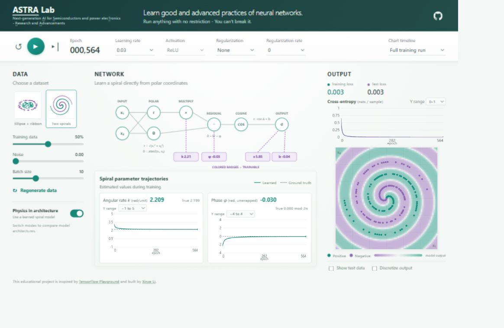

# Neural Network Playground

An interactive playground for learning and practicing key machine learning concepts. Explore classification, neural networks, feature selection, training, and regularization by changing settings and watching the results in real time. A physics-informed spiral model also illustrates how prior knowledge can be built into a network.

Training runs entirely in your browser. The project is inspired by [TensorFlow Playground](https://playground.tensorflow.org/) and built by [Xinze Li](https://github.com/XinzeLee).

## Try the playground

<!-- Replace both example.com URLs with the deployed web-app URL. -->
<a href="https://example.com/"></a>

[](https://example.com/)

The button and screenshot use a placeholder link until the playground is published.

## Run locally

Open `index.html` in a modern browser. No installation, server, or internet connection is required; keep `index.html`, `style.css`, and `playground.bundle.js` together.

To develop or run tests, install Node.js 24 and use:

```sh
npm run build  # regenerate the browser bundle after editing JavaScript
npm test       # check the bundle and run tests
```

There are no npm dependencies.

## Deploy to GitHub Pages

1. Put the contents of this folder in the root of a GitHub repository and push them to the `main` branch.
2. In **Settings → Pages → Build and deployment**, select **GitHub Actions** as the source.
3. From the **Actions** tab, run **Test and deploy to GitHub Pages**. Future pushes to `main` will test and publish automatically. The site will be available at `https://<username>.github.io/<repository>/`.

## Attribution

The spiral dataset generator is adapted from the [TensorFlow Playground source](https://github.com/tensorflow/playground/blob/master/src/dataset.ts), Copyright 2016 Google Inc. See [THIRD_PARTY_APACHE_LICENSE.txt](THIRD_PARTY_APACHE_LICENSE.txt) for its Apache 2.0 license.
